# Tutorial 1 : Problem Solving in Programming

## IPO | Pseudocode | Flowchart 

### **Part I:**  
### ✦Question 1  
Request two numbers from the user and print the multiplication of the numbers.  
### **IPO**  
**INPUT** — `num1` , `num2`   
**PROCESS** — Multiply `num1` by `num2` and store the result in `product`  
**OUTPUT** — `product`   

### **Pseudocode**  
```text
BEGIN
    Input num1, num2
    product = num1 * num2
    Output product
END
```

### **Flowchart**  
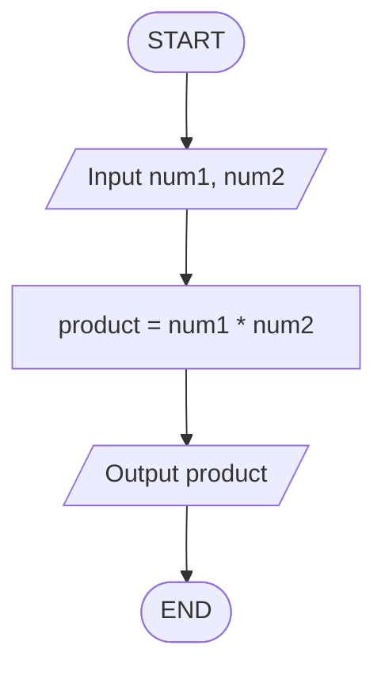

### ✦Question 2  
Determine whether a random number is greater than 50.  
### **IPO**  
**INPUT** — `none`   
**PROCESS** — Generate a random number `y` and check if `y>50`  
**OUTPUT** — Message indicating if the number is greater than 50   

### **Pseudocode**  
```text
BEGIN
    Generate random number y
    if y > 50
        Print "Greater than 50"
    else
        Print "Not greater than 50"
    endif
END
```

### **Flowchart**  
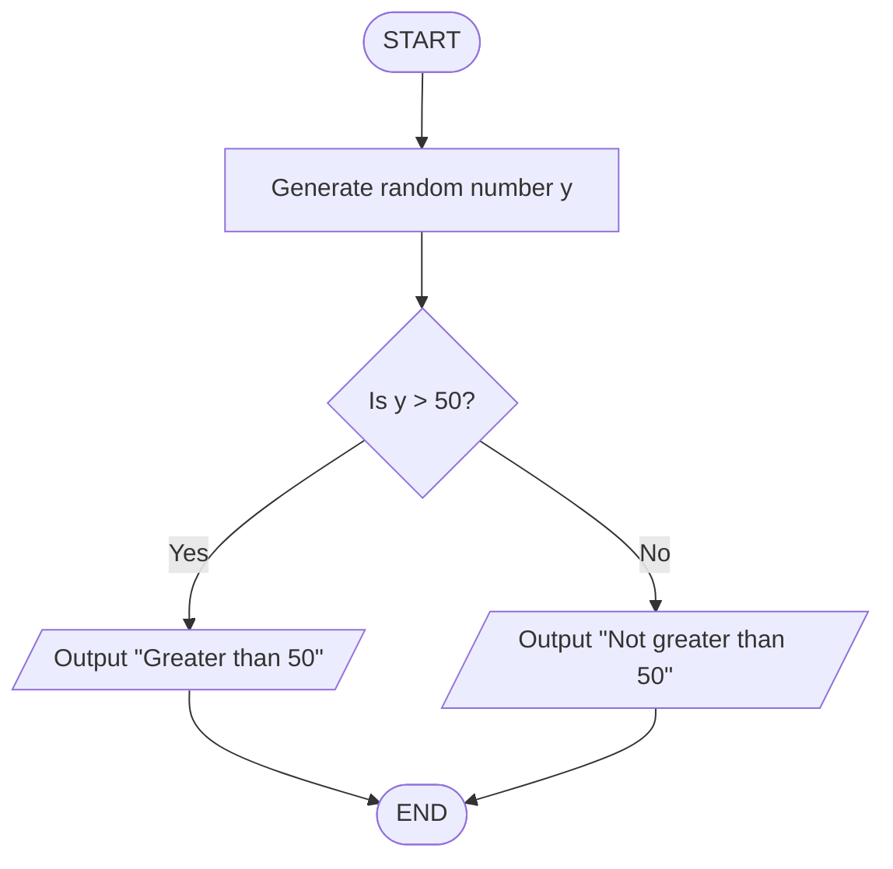

### ✦Question 3
Print the pass/fail grade based on the mark entered by user. The passing mark is at least 40.  
### **IPO**  
**INPUT** — `mark`   
**PROCESS** — Check if `mark >= 40`  
**OUTPUT** — Message indicating pass or fail grade  

### **Pseudocode**  
```text
BEGIN
    Input mark
    if mark >= 40
        Print "Your grade is pass"
    else 
        Print "Your grade is fail"
    endif
END
```

### **Flowchart**  
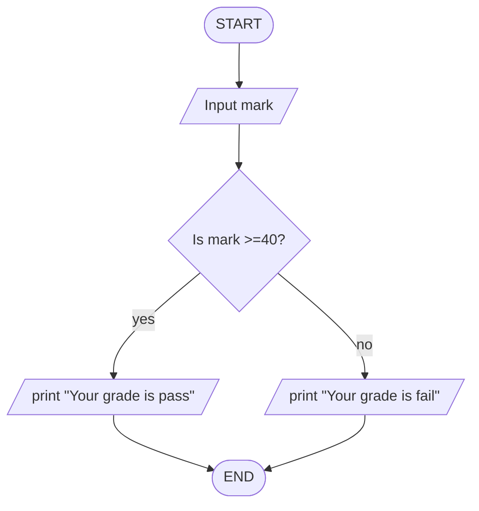

### ✦Question 4
Print the results of the two players’ dice game.  
### **IPO**  
**INPUT** — `none`   
**PROCESS** — Generate random dice rolls for two players and compare their values  
**OUTPUT** — Game outcome message("Player 1 Wins", "Player 2 wins", or "Tie")  

### **Pseudocode**  
```text
BEGIN
    Get player1, player2
        if player1 > player2
            Print "Player 1 Wins"
        else if player2 > player1
            Print "Player 2 Wins"
        else
            Print "Tie"
        endif
END
```

### **Flowchart**  
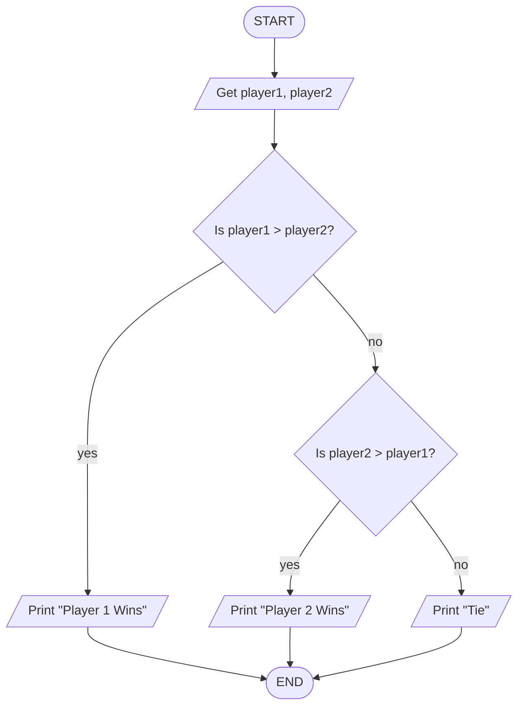

### ✦Question 5
Print the perimeter of a rectangle.  
### **IPO**  
**INPUT** — `width` , `length`   
**PROCESS** — Multiply the sum of width and length by 2 to get `perimeter`  
**OUTPUT** — `perimeter`   

### **Pseudocode**  
```text
BEGIN
    Input width, length
    perimeter = (width + length) * 2
    Print perimeter
END
```

### **Flowchart**  
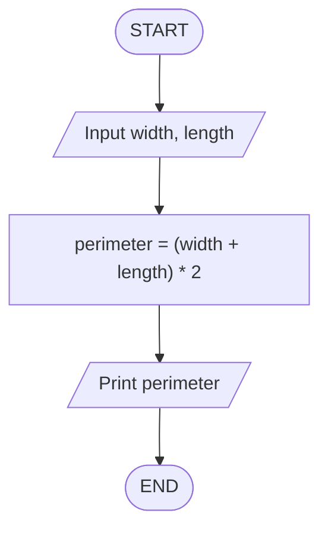

### ✦Question 6
Print the minimum number from 10 random numbers generated by computer.  
### **IPO**  
**INPUT** — `none`  
**PROCESS** — Generate 10 random numbers and track the minimum value.
**OUTPUT** — `min_num`

### **Pseudocode**  
```text
BEGIN
    min_num = RANDOM()
    counter = 2
    while counter <= 10
        current_num = RANDOM()
        if current_num < min_num THEN
            min_num = current_num
        endif
        counter = counter + 1
    endwhile
    Output min_num
END
```

### **Flowchart**  
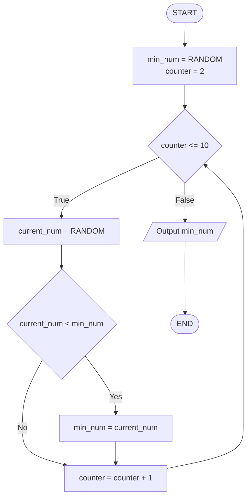

### ✦Question 7
Print the number of odd and even number from 10 random numbers generated by computer. The random number must be from 10 – 100.  
### **IPO**  
**INPUT** — `none`
**PROCESS** — Generate 10 random numbers between 10 and 100, then count the odd and even number
**OUTPUT** — `odd_num`, `even_num`   

### **Pseudocode**  
```text
BEGIN
     even_count = 0
     odd_count = 0
     counter =1
     while counter <= 10
        num = RANDOM(10,100)
        if num % 2 == 0 then
            even_count = even_count + 1
        else
            odd_count = odd_count + 1
        endif
        counter = counter + 1
    endwhile
    Print even_count, odd_count
END
```

### **Flowchart**  
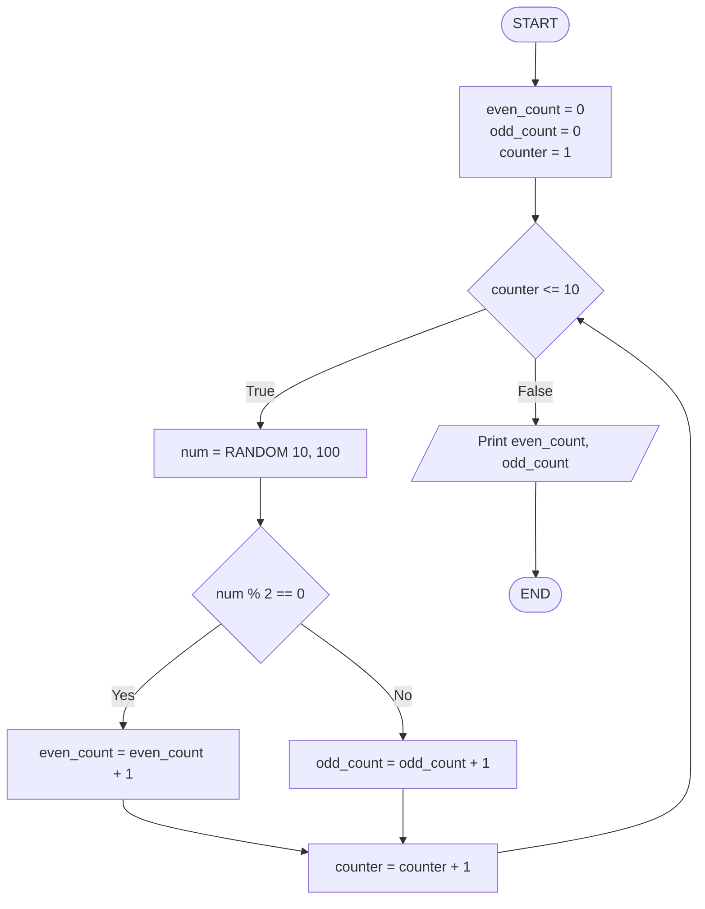

### **Part II:**  
### ✦Question 8
Count the number of alphabet U and M from a sentence entered by user.  
### **IPO**  
**INPUT** — `sentence`   
**PROCESS** — Loop through string text array bound array indexes to match letters 'U' and 'M'
**OUTPUT** — `u_count`, `m_count`   

### **Pseudocode**  
```text
BEGIN
     Input sentence
    u_count = 0
    m_count = 0
    index = 0
    length = LENGTH(sentence)
    
    while index < length
        char = GET_CHAR(sentence, index)
        if UPPER(char) == 'U' then
            u_count = u_count + 1
        else if UPPER(char) == 'M' then
            m_count = m_count + 1
        endif
        index = index + 1
    endwhile
    Print u_count, m_count
END
```

### **Flowchart**  
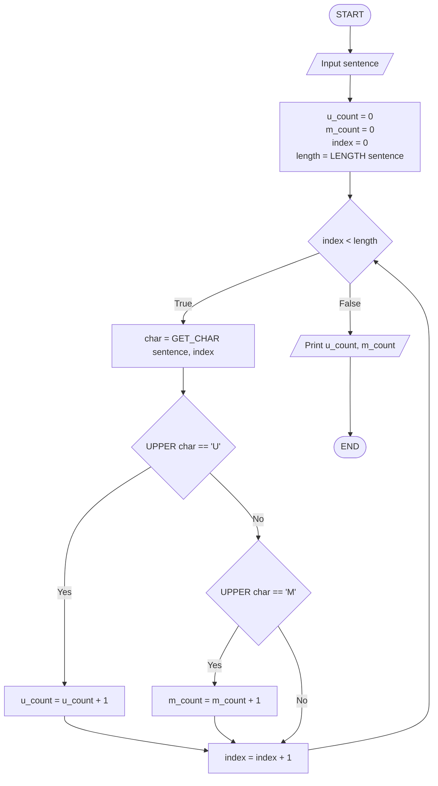

### ✦Question 9
Display the frequency of a keyword from a web page.  
### **IPO**  
**INPUT** — `webpage`, `keyword`   
**PROCESS** — Scan the words within the content and calculate match frequency
**OUTPUT** — `frequency`   

### **Pseudocode**  
```text
BEGIN
      Input webpage
    Input keyword
    frequency = 0
    
    for EACH word IN webpage
        if LOWER(word) == LOWER(keyword) then
            frequency = frequency + 1
        endif
    endfor
    Print frequency
END
```

### **Flowchart**  
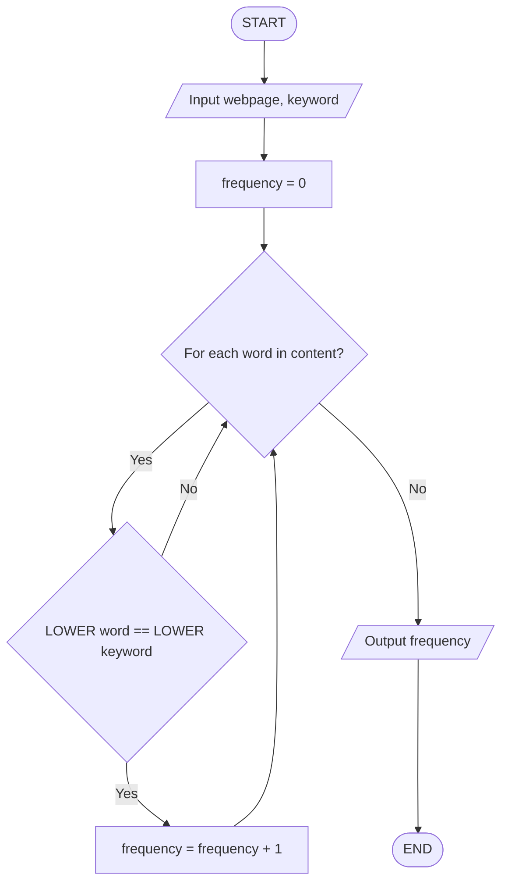

### ✦Question 10
Display the number of female student from a random list of 100 students.   
### **IPO**  
**INPUT** — `student_list`   
**PROCESS** — Check the gender attribute of every student entry inside a 100-step loop sequence
**OUTPUT** — `female_count`

### **Pseudocode**  
```text
BEGIN
    female_count = 0
    counter = 0
    while counter < 100
        student_gender = student_list[counter].gender
        if student_gender == "Female" then
            female_count = female_count + 1
        endif
        counter = counter + 1
    endwhile
    Print female_count
END
```

### **Flowchart**  
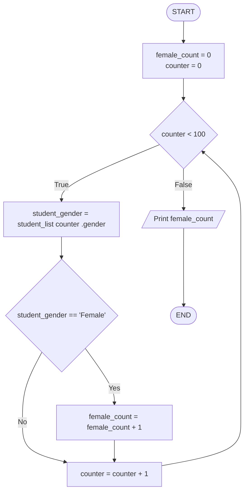

### ✦Question 11
Display a list of 5 random numbers in descending order. (Sort)     
### **IPO**  
**INPUT** — `none`   
**PROCESS** — Generate 5 random numbers, then sort them from largest to smallest
**OUTPUT** — `numbers`

### **Pseudocode**  
```text
BEGIN
    create array numbers of size 5
    counter = 0
    while counter < 5
        numbers[counter] = RANDOM()
        counter = counter + 1
    endwhile
    
    i = 0
    while i < 4
        j = i + 1
        while j < 5
            if numbers[i] < numbers[j] then
                temp = numbers[i]
                numbers[i] = numbers[j]
                numbers[j] = temp
            endif
            j = j + 1
        endwhile
        i = i + 1
    endwhile
    Output numbers
END
```

### **Flowchart**  
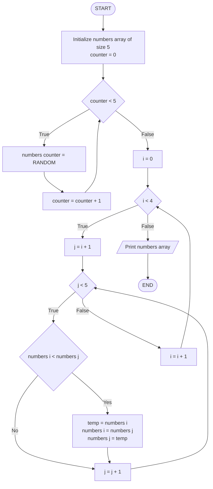

### ✦Question 12
Guess a random number generated by computer.   
### **IPO**  
**INPUT** — `user_guess`   
**PROCESS** — Match user guess to a random target number
**OUTPUT** — "Too high", "Too low", or "Correct"

### **Pseudocode**  
```text
BEGIN
    target_num = RANDOM(1, 100)
    user_guess = 0
    
    while user_guess != target_num
        Input user_guess
        if user_guess > target_num then
            Print "Too high, try again."
        else if user_guess < target_num then
            Print "Too low, try again."
        else
            Print "Correct! You guessed the number."
        endif
    endwhile
END
```

### **Flowchart**  
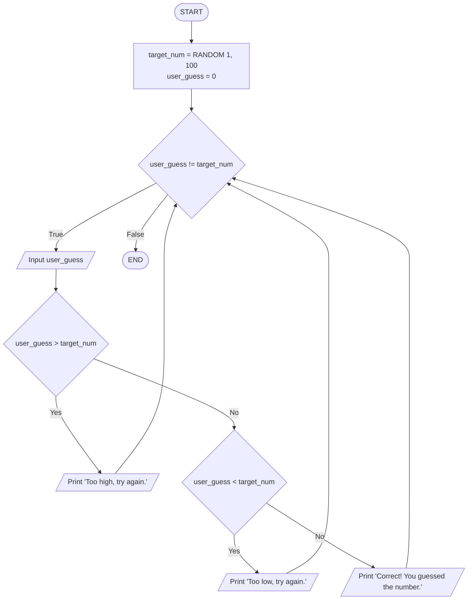